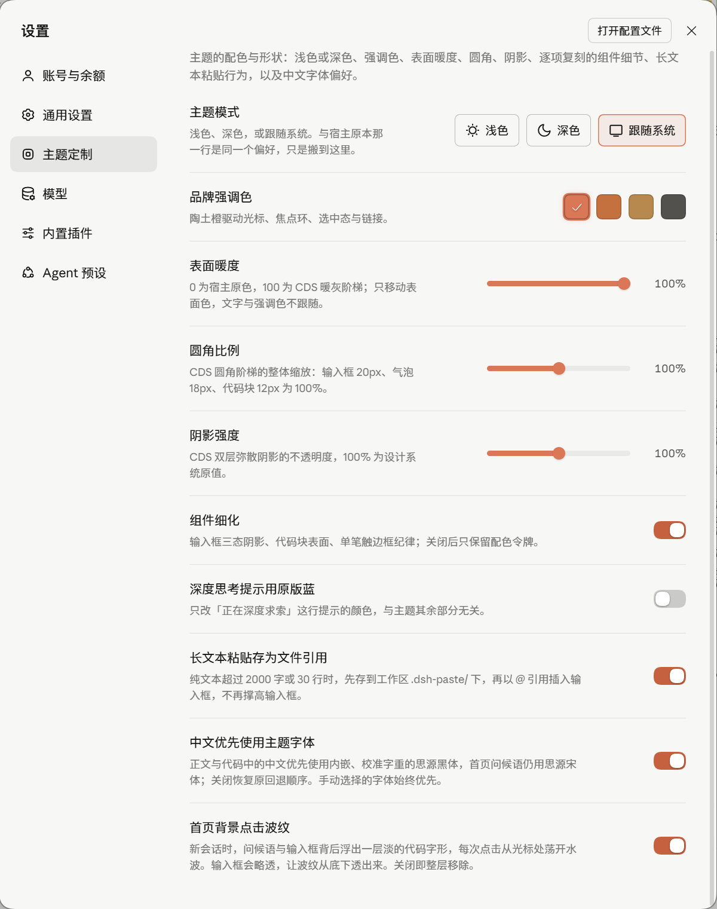

[English](README.md) | **简体中文**

# HwFee-dsh

给 **DeepSeek Harness (DSH)** 做的三个插件：一套按 Claude Design System 重做的主题、一个换字体的插件、一张新对话页上的用量面板。

三个包互相独立，各自有自己的构建和测试，可以只装一个，也可以随时关掉或卸掉，不会互相改对方的令牌。

## 直接装（已发布到 npm）

在命令行里跑，或者在 DSH 的 **设置 → 插件 → 添加插件** 输入框里直接填包名：

```bash
# 1. 主题（配色、排印、圆角阴影、组件细节）
dsh plugin --profile desktop add dsh-cds-theme

# 2. 系统字体（正文 / 代码 / 终端字体下拉 + 行距字距）
dsh plugin --profile desktop add dsh-system-fonts

# 3. 用量面板（新对话页统计卡片 + 热力图）
dsh plugin --profile desktop add @hwfee/dsh-usage-stats
```

**装完或卸完之后，彻底退出并重开 DSH。** 插件是在启动组装 Profile 的时候挂载的，不重启不会生效。

卸载：

```bash
dsh plugin --profile desktop remove dsh-cds-theme
dsh plugin --profile desktop remove dsh-system-fonts
dsh plugin --profile desktop remove @hwfee/dsh-usage-stats
```

> 如果遇到 `Unexpected end of TAR archive`，是国内镜像（npmmirror）还没同步刚发的新版本。加上官方源再装就行：
> ```bash
> dsh plugin --profile desktop add @hwfee/dsh-usage-stats --config.registry=https://registry.npmjs.org
> ```

---

## 长什么样

| 对话页（工具调用与思考状态） | 代码块与 Diff 渲染 |
| :---: | :---: |
|  |  |

| 「主题定制」设置页 | 新对话页（衬线问候语 + 用量面板） |
| :---: | :---: |
|  |  |

<details>
<summary>英文界面预览（文案随宿主语言切换）</summary>


</details>

---

## 三个插件分别干什么

### 1. `dsh-cds-theme`（v0.1.1）— 整套外观重做

参考的是 [Caho1/open-claude-ui](https://github.com/Caho1/open-claude-ui)（MIT，对 Anthropic Claude Design System 的逆向整理），但我没有原封不动照抄——觉得顺眼的留下来，水土不服的按自己的判断改了。

- **316 个设计令牌**：走宿主的 `ctx.theme.overrideTokens` 直接换掉令牌表（DSH 把主题令牌内联写在 `<body>` 上，单写 CSS 覆盖不了）。包含暖灰表面阶梯、陶土橙强调色、`hsla(0,0%,8%,α)` 发丝边框、双层弥散阴影、三层焦点环，明暗两套配色。
- **内嵌 8 个字体文件**：6 个 Anthropic 官方可变字体（Sans / Serif / Mono × Roman / Italic）+ 2 个做过 `avar` 字重轴校准的思源黑体/宋体子集。全部在构建时内联成 `data:font/woff2`，不走网络请求，在桌面端 `dsh-app://` 下也能直接加载。
- **组件级打磨**：首屏问候语换成衬线 Display（38px / wght 330）；聊天里的 Markdown 表格加上闭合发丝外框、浅底表头和等宽数字；代码块铺 `#0d0d0c` 暖黑底；思考提示改成柔和的呼吸微光。
- **独立的「主题定制」设置页**：在设置侧栏里和「通用」同级。里面有浅色/深色/跟随系统、4 种强调色（陶土 / 赭石 / 砂金 / 石墨）、表面暖度、圆角比例、阴影强度、组件细化开关、思考提示保留原版蓝、长文本（>2000 字或 >30 行）粘贴自动转 `@` 文件引用、中文字体优先开关。
- **首页点击波纹（半成品，可关）**：还原 Claude Code 桌面版上线一天就撤掉的空白页代码字形背景 + 点击光波。目前效果还比较粗糙，在「主题定制」最底下留了开关，不喜欢随时关掉。

详见 [`plugins/cds-theme/README.md`](plugins/cds-theme/README.md)。

### 2. `dsh-system-fonts`（v0.1.0）— 换字体、调行距

这个插件只管字族和间距，绝不碰配色，也不写任何 `font-weight`（字重阶梯归主题管，乱插一脚会把层次全搅乱）。

- **三个字体槽**：在 **设置 → 通用 → 字号大小（展开）** 里，把原本要手打名字的三个输入框（正文 / 代码 / 终端）换成下拉菜单。
- **读取本机已装字体**：在 Windows 上合并 GDI 字体集、注册表 `Fonts` 键和字体文件里的 OpenType 元数据，中英文名字归到同一族。
- **行距与字距滑块**：行距 50%–100%，字距 −0.30em ~ +0.30em，拖动实时生效；字号仍然交给宿主原本的步进器。

详见 [`plugins/system-fonts/README.md`](plugins/system-fonts/README.md)。

### 3. `@hwfee/dsh-usage-stats`（v0.1.1）— 看自己花了多少 Token

在新对话页标题下方加一张统计卡片，数据直接从本机 `~/.dsh/sessions` 的会话日志里算出来，不上传任何东西。

- **六个指标 + 模型排行**：会话数、消息数、总 Token、活跃天数、高峰时段、最常用模型；切到「模型」标签页能看每个模型的消耗占比，右上角可以切「全部 / 30 天 / 7 天」。
- **活跃度热力图 + 书目折算**：右下角固定是今天，往前铺满整周；底下随机抽一本书（《红楼梦》《三国演义》《围城》《活着》《骆驼祥子》）折算你用掉的 Token 相当于几本书。
- **带磁盘缓存**：DSH 的日志是多段 zstd 帧拼在一起的，第一次打开需要约 2 秒冷解析，之后缓存在 `~/.dsh/cache/usage-stats/`，每次重开约 20 毫秒。面板高度（240–520px）和数字单位（万/亿 或 K/M/B）可以在「主题定制」页调。

详见 [`plugins/usage-stats/README.md`](plugins/usage-stats/README.md)。

---

## 其他安装方式（插件市场 / 离线包 / 源码）

DSH 里有三个地方能装插件，但它们填的东西不一样：

| 入口 | 填什么 |
|---|---|
| **命令行** `dsh plugin --profile desktop add <内容>` | npm 包名、`.tgz` 链接、或本地 `link:<目录>` |
| **GUI：设置 → 插件 → 添加插件** | 跟命令行一模一样 |
| **GUI：插件 → 发现**（要先开「自定义插件市场」） | 只能填下面那个 `index.json` 的市场地址，不能填包名 |

**方式 A：自定义插件市场**

在设置里开启「自定义插件市场」，填入：

```text
https://raw.githubusercontent.com/HwFee/HwFee-dsh/master/market/index.json
```

**方式 B：直接装 GitHub Release 的 `.tgz` 包**

不想走 npm 的话，直接把下面的地址填进「添加插件」或命令行：

- `https://github.com/HwFee/HwFee-dsh/releases/download/v0.1.1/dsh-cds-theme-0.1.1.tgz`
- `https://github.com/HwFee/HwFee-dsh/releases/download/v0.1.0/dsh-system-fonts-0.1.0.tgz`
- `https://github.com/HwFee/HwFee-dsh/releases/download/v0.1.1/hwfee-dsh-usage-stats-0.1.1.tgz`

> 别用 `git+https://github.com/HwFee/HwFee-dsh.git#...&path:/plugins/...` 这种写法——DSH 底层的 pnpm 装 git 依赖时只认仓库根目录，忽略子目录参数，装上去不会生效。

**方式 C：本地克隆源码（改代码用）**

三个插件编译好的 `client/client.js` 都已经提交在仓库里，克隆下来直接 `link:` 就能用。如果你改了源码，重新 `npm run build` 再重启 DSH：

```bash
git clone https://github.com/HwFee/HwFee-dsh.git
cd HwFee-dsh/plugins/cds-theme
npm ci && npm run build
dsh plugin --profile desktop add link:.
```

---

## 仓库目录与测试

目前三个插件一共 **667 条测试**（`cds-theme` 398 条、`system-fonts` 156 条、`usage-stats` 113 条），外加一份仓库级静态检查脚本：

```bash
# 在任一插件目录里跑构建与测试
cd plugins/cds-theme
npm test

# 在仓库根目录跑体积预算、DOM 安全、生命周期与产物新鲜度检查
node tools/audit.mjs
```

```text
HwFee-dsh/
├── plugins/
│   ├── cds-theme/        # 主题插件（398 条测试）
│   ├── system-fonts/     # 系统字体插件（156 条测试）
│   └── usage-stats/      # 用量统计插件（113 条测试）
├── market/               # 插件市场 index.json 与发布脚本
├── docs/                 # 取证笔记：cds-spec.md（逐行色值出处）、host-hooks.md（宿主钩子勘察）
├── assets/               # README 预览截图
└── tools/audit.mjs       # 全仓静态检查
```

> `skills/dsh-plugin-guide/` 是顺带放在仓库里的第三方插件开发资料（Apache-2.0），包含 DeepSeek 官方文档归档，和上面三个插件没有运行时依赖关系。
