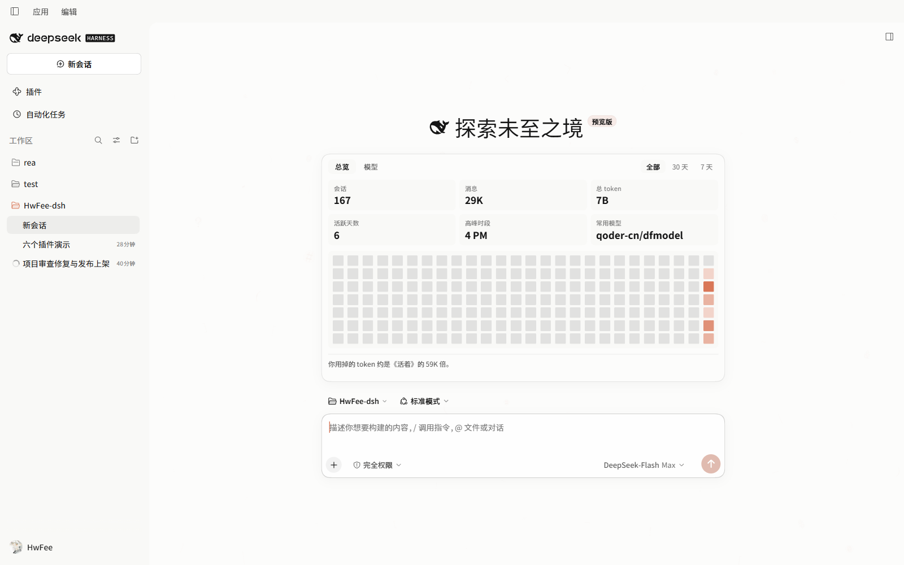

[English](README.md) | **简体中文**

# HwFee-dsh

六个 **DeepSeek Harness（DSH）** 插件：一套 Claude 风格主题、一组字体与字号设置、一张本地用量面板、生成式 UI 卡片、下一句预测，以及让 `run_shell` 走 Git Bash。



英文界面：[assets/screenshot-home-en.png](assets/screenshot-home-en.png)。

## 六个插件

| 包名 | 一句话作用 | 安装名 |
|---|---|---|
| [`dsh-cds-theme`](https://www.npmjs.com/package/dsh-cds-theme) | 重做宿主外观：配色、排印、圆角、阴影，以及代码块、表格、工具卡的组件样式 | `dsh-cds-theme` |
| [`dsh-system-fonts`](https://www.npmjs.com/package/dsh-system-fonts) | 内容 / 代码 / 终端 / 界面四个字体槽，加行内代码与界面字号、行高、字距 | `dsh-system-fonts` |
| [`@hwfee/dsh-usage-stats`](https://www.npmjs.com/package/@hwfee/dsh-usage-stats) | 新对话页上的用量面板，从本机会话日志聚合 | `@hwfee/dsh-usage-stats` |
| [`@hwfee/dsh-genui`](https://www.npmjs.com/package/@hwfee/dsh-genui) | `render_ui`：模型用一张可交互卡片回答，而不是写一段话 | `@hwfee/dsh-genui` |
| [`@hwfee/dsh-git-bash`](https://www.npmjs.com/package/@hwfee/dsh-git-bash) | Windows 上让 `run_shell` 走 Git Bash，带一行 shell 设置 | `@hwfee/dsh-git-bash` |
| [`@hwfee/dsh-predict`](https://www.npmjs.com/package/@hwfee/dsh-predict) | 输入框里的浅色「下一句」，Tab 填入 | `@hwfee/dsh-predict` |


每个插件是独立包，有自己的清单、预构建产物和测试。可以只装一个，也可以六个都装；关掉其中任何一个，宿主回到原样。

## 六个插件分别能做什么

### `dsh-cds-theme` — Claude 风格主题

319 个设计令牌走宿主的 `overrideTokens`（配色 173、排印 133、圆角/阴影/缓动 13，明暗各一套），组件规则一律挂在宿主公开的 `data-*` 钩子上，不碰会随构建变化的哈希类名。

- **组件细节**：空白页的衬线 Display 问候语；Markdown 表格闭合发丝外框、浅底表头、等宽数字；代码块浅色下白底、深色下 `#1a1a19`；工具调用统一成「一张卡」；编辑 / 写入卡片由主题自绘，带按语言分词的着色和词级改动高亮。
- **独立的「主题定制」设置页**（与「通用」同级）：浅色/深色/跟随系统、四种强调色、表面暖度、圆角比例、阴影强度、组件细化开关、中文优先、长文本粘贴转文件引用、首页点击波纹。
- **代码块默认换行**，宿主的「不换行」开关被移除——这个主题不提供不换行这个状态。


限制：主题依赖宿主的具体钩子与槽位，宿主改了这些钩子时，某条组件规则可能匹配不到东西，直到插件跟进更新。不想要组件样式就把「组件细化」关掉，只保留令牌。

完整设置项与实现说明：[`plugins/cds-theme/README.md`](plugins/cds-theme/README.md)。

### `dsh-system-fonts` — 字体与间距

- **四个字体槽**：内容、代码、终端沿用宿主原来的行位置，另加一个**界面字体**（未设置时跟随正文）。
- **两个像素步进器**：界面字号（10–20px，未设置时 14px）只放大界面文字、不动布局；行内代码字号（10–20px，未设置时 12px）只影响行内代码。
- **行高与字距滑块**，拖动后立即生效。
- **Windows 字体枚举**合并 GDI 字族、注册表与字体文件里的 OpenType 名称，`PingFang SC` 和 `苹方-简` 会归到同一条。


限制：只改字族和间距，不写 `font-weight`，也不碰配色。宿主自己 CSS Module 里写死的字号（侧栏、设置行文字）CSS 够不到；界面字号作用于文本节点，不是每一个固定 px。

行序与字体枚举：[`plugins/system-fonts/README.md`](plugins/system-fonts/README.md)。

### `@hwfee/dsh-usage-stats` — 本地用量面板

空白页问候语下方一张卡片，全部从本机 `~/.dsh/sessions` 算出来，不发任何网络请求：

- **六个指标**——会话数、消息数、Token、活跃天数、高峰时段、最常用模型——加一个「模型」标签页看各模型占比，可切全部 / 30 天 / 7 天。
- **活跃度热力图**，最后一格永远是今天；底部再按一本经典小说的字数折算你用了多少 Token。
- **带持久账本**：第一次冷解析要几秒，之后读 `~/.dsh/cache/usage-stats/` 缓存。数字只增不减——删掉会话日志不会从总数里减掉，想清零就删账本文件重建。

面板就是本页顶部那张截图里问候语下方的卡片。

限制：数据来自本机日志，新机器从零开始；它是累计账本，不是「磁盘上现在有什么」的快照。

缓存、账本与高度设置：[`plugins/usage-stats/README.md`](plugins/usage-stats/README.md)。

### `@hwfee/dsh-genui` — 生成式 UI 卡片

模型调 `render_ui`，回答就地变成对话里一张活的 React 卡片：图表、对比表、表单、开关。卡片上的按钮能改卡片自己的状态。


- **卡片代码跑在没有 `allow-same-origin` 的沙箱 iframe 里**，文档是 opaque origin；帧内 CSP 再挡掉成文的网络 API、导航、嵌套帧与表单。
- **`interact()` 只是请求，不是发送。** 宿主在帧外画一条确认行，显示待发送的原句和发送 / 丢弃两个按钮，只有点击才真的进对话。
- **自带 React**：React、ReactDOM、Scheduler 在构建时打进帧产物，卡片碰不到宿主的 React 实例和模块表。
- 出错时在卡片位置显示原因，源码留在一个开关后面。

限制：它保证卡片读不到宿主页面、宿主存储和 cookie（是读不到，不是藏起来），也保证卡片不能替你说话。它不保证模型写的代码无害——那些代码照样在它自己的帧里执行。

CSP、消息校验与卡片能做什么：[`plugins/genui/README.md`](plugins/genui/README.md)。

### `@hwfee/dsh-git-bash` — Git Bash 当 shell

加一个 `run_shell` 工具，以及 **默认 shell** 设置行，三种模式：自动 / Windows PowerShell / Git Bash。

- **找真正的 Git for Windows bash**，不是 `C:\Windows\System32\bash.exe` 那个 WSL 替身：先看 `DSH_GIT_BASH`，再走 `git --exec-path`，最后试常见安装位置。
- **每条结果都写清在哪跑的**：`· host` 走宿主的 `ctx.shell` 并带上会话的沙箱模式，`· direct` 由插件自己 spawn。
- **受限会话直接拒绝（fail closed）**：Git Bash 进不了 Windows 沙箱，所以只读、`workspace-write` 和判定不出模式的会话都在**启动任何进程之前**报错。提示指向 Windows PowerShell，不会让你放宽沙箱。只有明确的 `danger-full-access` 会话才直连。
- **取消、超时、输出超限会真正停掉进程树**，不只是插件自己起的那个 shell。


限制：Windows 上 POSIX 命令只在允许直连的会话里可用，受限会话里同一个请求返回错误——这是设计，不是故障。

shell 解析与沙箱判定表：[`plugins/git-bash/README.md`](plugins/git-bash/README.md)。

### `@hwfee/dsh-predict` — 下一句

每轮回答结束后，输入框里出现一句浅灰的预测。按 **Tab** 填入，不发送。


- **旁路**：在 `turn/end` 之后走宿主自己的 LLM 服务，关闭推理。不写会话日志、不占回合，失败也不会在对话里留下东西。
- **会把最近几轮发给你的 provider**：每次预测是一次短请求，带最近几轮对话，走和正常回合相同的供应商、凭据与计费。插件自己不建连接；不想让这些片段离开本机，就关掉这一行。
- **会退避**：连续失败三次安静十轮；单次预测超过 20 秒直接放弃。

限制：会话第一轮不预测；模型什么都不返回时这一轮就没有预测，那是正常的空结果，不是错误。

设置、时机表与数据流：[`plugins/predict/README.md`](plugins/predict/README.md)。

## 安装

命令行：

```bash
dsh plugin --profile desktop add dsh-cds-theme
dsh plugin --profile desktop add dsh-system-fonts
dsh plugin --profile desktop add @hwfee/dsh-usage-stats
dsh plugin --profile desktop add @hwfee/dsh-genui
dsh plugin --profile desktop add @hwfee/dsh-predict
dsh plugin --profile desktop add @hwfee/dsh-git-bash
```

也可以把同样的包名填进 **设置 → 插件 → 添加插件**。

**装完或卸完都要彻底退出并重开 DSH。** 插件在应用启动时加载，只刷新页面不够。卸载把 `add` 换成 `remove`：

```bash
dsh plugin --profile desktop remove dsh-cds-theme
```

这份文档不写死版本号，当前版本以 npm 页面或 Releases 页面为准。

### 没有 npm 账号：从 GitHub Release 装

每个包都在 [Releases](https://github.com/HwFee/HwFee-dsh/releases) 上有一个 `.tgz` 资产。六个包版本各自演进，所以一个包一个 tag：

| | |
|---|---|
| tag | `<插件>-v<版本>`，例如 `cds-theme-v<版本>` |
| 资产名 | 就是 `npm pack` 的文件名；scoped 包要去掉 scope，`@hwfee/dsh-genui` 是 `hwfee-dsh-genui-<版本>.tgz` |
| 安装 | `dsh plugin --profile desktop add <资产 URL 或本地 .tgz 路径>` |

去 Release 页面点资产，别手拼地址——漏掉 `hwfee-` 前缀、或者把 `@scope/` 也写进去，都是 404。

两条走不通的路：git 子目录（`git+https://…#…&path:/plugins/…`，pnpm 只装仓库根、忽略子目录参数），以及旧的共享 tag（里面只有首发那批包）。以按包分的 tag 为准。

### 从源码装

预构建的 `client/client.js` 已提交进仓库，克隆下来可以直接 `link:`：

```bash
git clone https://github.com/HwFee/HwFee-dsh.git
cd HwFee-dsh/plugins/cds-theme
npm ci && npm run build
dsh plugin --profile desktop add link:.
```

### 版本装不上时

很多机器的默认 registry 是 `registry.npmmirror.com`，只读镜像、同步晚一步。版本找不到或报 `Unexpected end of TAR archive` 时，锁版本并走官方源：

```bash
dsh plugin --profile desktop add dsh-cds-theme@<版本> --config.registry=https://registry.npmjs.org
```

不锁版本的安装仍可能落到上一版；我们在一台并未配置 `minimumReleaseAge` 的机器上复现了这一点，成因未定位。需要新版时请锁版本或直接用 Release 资产。

另外提醒一件事：插件从 `link:` 变成 npm/Release 实体后，profile 就不再指向工作区，此后在工作区改源码、重建 bundle 都不会生效，除非重新用 `link:` 安装一次。而实体化安装会先清掉 `link:` 指向目录的内容——源码还没 commit + push 时这么做，工作区文件会被删除。

## 字体与许可

主题带两类字体，许可完全不同：

| | |
|---|---|
| 内联成 `data:font/woff2` | **2 个** —— 思源黑体 / 宋体子集（Noto，SIL OFL），做过 `avar` 字重校准，让中文笔画宽细对上拉丁的 8 档字重。这是包里唯一的字体字节 |
| 6 个 Anthropic 字面（Sans / Serif / Mono × Roman / Italic） | 商业字体，**没有再分发授权**：只声明成 `local()`，**随包零字节** |
| 对你意味着什么 | 本机装了这些字族，`local()` 命中；没装就回落到系统字体 |
| 那 6 个源文件 | 已从 git 取消跟踪、由 `.gitignore` 挡住，fresh clone 里没有 |
| 靠什么守住 | 构建发现受限字节就失败；包内测试复核提交进 git 的产物，并断言这些文件仍未被跟踪；仓库审计覆盖所有产物；发布闸门打开真实 tarball 按内容认字。字面靠 [`tools/font-licences.mjs`](tools/font-licences.mjs) 里的哈希与前 96 字节识别，所以四道闸门在没有这些文件的机器上也生效 |

这次改动之前发布的版本仍然内联着 8 个字面，不会追溯修改；装改动之后的构建。复核方法与命令行在 [`market/PUBLISHING.md`](market/PUBLISHING.md)。

## 安全边界

短版，不含「绝对」这类保证：

| 插件 | 边界 |
|---|---|
| `genui` | 卡片代码跑在没有 `allow-same-origin` 的 iframe 里，宿主 DOM、`localStorage`、cookie 对它**读不到**，不是被遮起来。发送要点宿主那条确认行。这不等于模型写的代码无害；CSP 挡的是成文的网络 API，扩展与代理不在其内 |
| `git-bash` | Windows 上 Git Bash 进不了宿主沙箱，受限或判定不出模式的会话在**启动进程之前**就被拒绝；只有 `danger-full-access` 直连。取消、超时、输出超限会停掉进程树 |
| `predict` | 把最近几轮对话发给你配置的 provider，走正常模型请求 |
| `usage-stats` | 读 `~/.dsh/sessions`，写一份计数账本；不联网 |

## 从旧版本升级会察觉到的变化

1. **卡片发送多一步确认。** `interact` 现在只生成待确认请求，卡片不能自己把文字塞进对话。
2. **Windows 受限会话里 Git Bash 会被拒。** 以前只读 / `workspace-write` 会话能跑的命令，现在返回错误并提示改用 Windows PowerShell。
3. **没装 Anthropic 字族的机器，拉丁文走系统回退字体**，因为这些字面不再内联。中文不受影响，思源子集仍在包里。
4. **新增的字体行初始未设置**，显示默认值（界面字号、行内代码字号），你不去点它就不会改变现状。

## 仓库结构

```text
HwFee-dsh/
├── plugins/
│   ├── cds-theme/        # 主题令牌与组件规则
│   ├── system-fonts/     # 字体与间距设置行
│   ├── usage-stats/      # 本地用量面板
│   ├── genui/            # render_ui 卡片
│   ├── predict/          # 下一句预测
│   └── git-bash/         # run_shell 走 Git Bash
├── assets/               # 这两份 README 用的截图
├── market/               # 市场索引、catalog 条目、发布脚本
├── docs/                 # 取证文档（规范、宿主钩子、审计）
├── patches/              # 可选的宿主补丁
└── tools/audit.mjs       # 全仓静态审计
```

每个插件目录都有自己的 `npm test`：先查产物新鲜度，再查清单契约，然后跑各套单测。条数随修改变动，看输出而不是看这里写的数字。

```bash
cd plugins/cds-theme
npm test

node tools/audit.mjs   # 全仓：产物体积预算、unsafe DOM、观察器生命周期、令牌成对
```

维护规则（包括为什么重建产物后必须彻底重开应用、而不是刷新页面）见 [AGENTS.md](AGENTS.md)。
