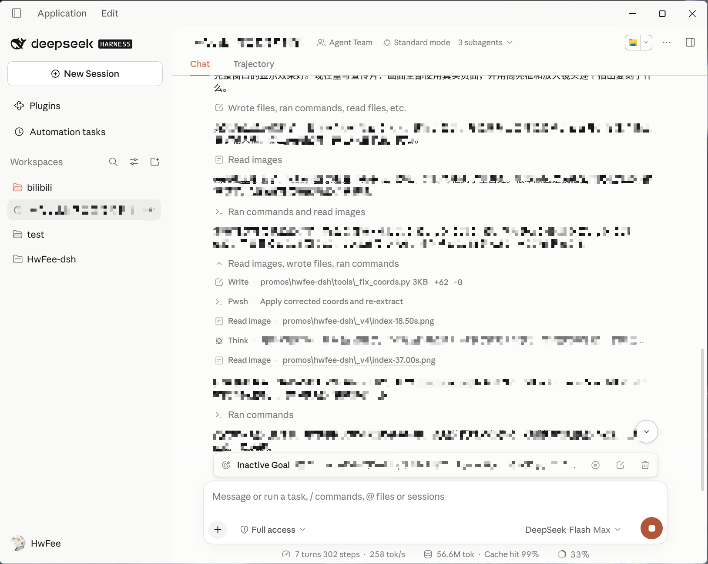
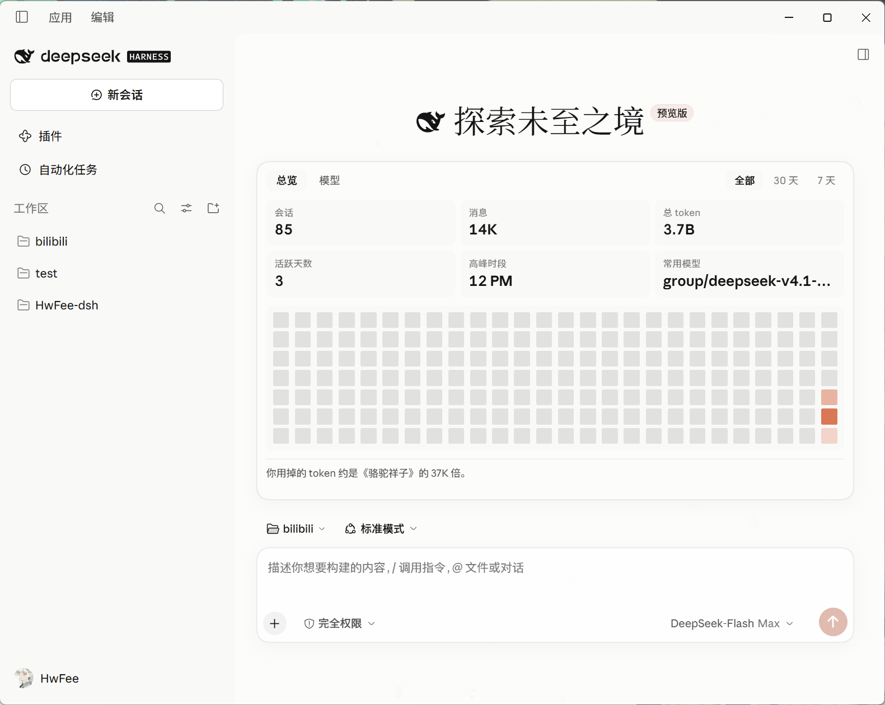
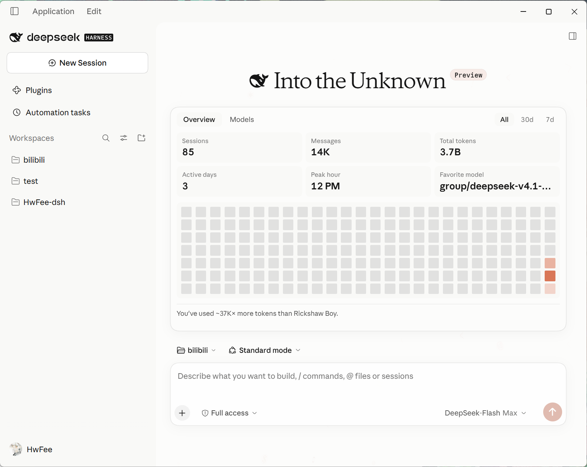

# HwFee-dsh — DeepSeek Harness 插件套件

针对 **DeepSeek Harness (DSH)** 深度打造的现代化模块化插件套件。每个插件均为独立设计与打包（位于 `plugins/` 目录下），拥有专属配置清单、补丁定义、构建流水线与自动化测试套件，支持按需独立安装、零干扰平滑启停。



| 中文界面（首页衬线字体与用量统计面板） | 英文界面（CDS 令牌多语言自适应） |
| :---: | :---: |
|  |  |

*插件套件实机交互效果：包含 CDS 主题的暖灰表面阶梯与陶土橙强调色、首页衬线 Display 问候语、多维度用量统计面板、Agent 执行流程卡片以及输入框与代码块等组件级交互细节。*

## 设计溯源 · Design Provenance

**本项目的设计语言严格对齐开源项目 [open-claude-ui](https://github.com/Caho1/open-claude-ui)** —— 该项目遵循 MIT 协议，是对 Anthropic **Claude Design System (CDS)** 进行干净室逆向还原的完备实现。本项目遵循严谨的设计系统工程实践，而非主观拼凑：从设计令牌阶梯、双环焦点态、有机动效曲线、单像素发丝边框，到诸多组件的交互规格，均逐项考证并精确复现自该规范。

**规范落地与溯源体系**：

- **逐行考证**：[`docs/cds-spec.md`](docs/cds-spec.md) 详细记录了提取自参考仓库的全部规范项，每个度量与色值均精确标注原始 `文件:行号`，并附带针对上游 18 处规范冲突的详细仲裁说明；
- **同步溯源**：`plugins/cds-theme/client/src/palette.js` 中所有颜色变量均内联标注规范来源注释，任何数值变更必须同步更新引证；
- **环境隔离**：参考仓库作为只读克隆存放于 `.reference/`（已列入 `.gitignore`，**不纳入版本控制**），仅作为本地开发对照依据，完全解耦于构建链路。

> [!NOTE]
> **关于首页交互波纹的特别说明**：
> 首页点击波纹效果未包含在上游参考仓库中（规范全分支检索 `ripple` / `glyph` / `code symbol` 均为 0 命中）。该特性系复现自 Claude Code 桌面版曾短期上线的首页实验交互（参见 [anthropics/claude-code#102952](https://github.com/anthropics/claude-code/issues/102952)）。
> 尽管属于扩展复现，其实现**在技术哲学上完全遵从 CDS 的既有范式**：参考仓库中唯一的 Canvas 光晕范例（`ReasoningAmbientGlow.tsx` 中的 `AmbientLightFieldCanvas`）确立了「径向渐变柔光渲染、杜绝线条描边」的核心原则 —— 首页波纹严格沿用这一光晕算法，呈现自然扩散的柔和场域，而非机械的同心几何圆环。

*The design language is derived from [open-claude-ui](https://github.com/Caho1/open-claude-ui), a clean-room reverse-engineered implementation of the Claude Design System (CDS) under the MIT license. Rather than inventing arbitrary styles, this project rigorously aligns with CDS standards: token ladders, dual-ring focus states, organic motion curves, single-stroke border disciplines, and component specifications are directly extracted with precise file:line citations documented in `docs/cds-spec.md`. The sole deliberate exception is the home-screen click ripple effect, which was not present in the reference repository (zero hits for `ripple` / `glyph` / `code symbol`) and reconstructs an experimental Claude Code desktop feature. Even so, it adheres strictly to CDS design principles by following the reference repository's canvas ambient light model (`AmbientLightFieldCanvas`) — rendering soft radial gradients without hard stroke borders.*

## 插件矩阵 · Plugins

| 插件 | 目录 | 核心定位与特性 |
|:---|:---|:---|
| **`dsh-cds-theme`** | [`plugins/cds-theme`](plugins/cds-theme) | **Claude Design System 完整主题体系**<br>• 将宿主全套 `--dsw-*` 设计令牌重映射至 CDS 标准（暖灰表面阶梯、陶土橙强调色、双环焦点与有机动效）<br>• 输入框、侧边栏、消息行、代码块及 Markdown 渲染的组件级细节打磨<br>• 内嵌 Anthropic 官方可变字体，首屏问候语支持衬线 Display 排印<br>• 空白会话代码字形矩阵背景与交互点击波纹动效<br>• 长文本粘贴智能转存为轻量文件引用<br>• 独立挂载「主题定制」设置面板，支持色彩、暖度、圆角及阴影微调 |
| **`dsh-system-fonts`** | [`plugins/system-fonts`](plugins/system-fonts) | **系统字体与排印精细化配置**<br>• 为正文/界面、代码块、集成终端独立提供字体族槽位<br>• 智能枚举 Windows 本地系统字体（融合 GDI、注册表与 OpenType 元数据）<br>• 提供高精度行距（Line Height）与字距（Letter Spacing）实时调节<br>• 纯粹专注排印布局，严格不干预主题预设字重与调色体系 |
| **`dsh-usage-stats`** | [`plugins/usage-stats`](plugins/usage-stats) | **多维会话用量分析看板**<br>• 可视化呈现历史会话数、消息量、Token 总消耗及活跃天数<br>• 统计高峰活跃时段与常用模型分布，内置 GitHub 风格交互热力图<br>• 支持「全部历史 / 30 天 / 7 天」多时间窗口快速切换<br>• 高效内存缓存与异步聚合，毫秒级即时响应 |

> **架构解耦保障**：三款插件各司其职、完全解耦，支持任意单独安装或组合使用。各插件严格遵循所有权隔离原则，仅声明并操作专属的设计令牌与扩展槽位，杜绝状态竞争与样式污染。

## 快速上手 · Installation

### 1. 构建与添加插件

在目标插件目录下构建产物，并通过 `link:` 软链形式添加至宿主 Profile：

```bash
# 以 cds-theme 为例：构建客户端产物（使用 link 协议时宿主不会自动触发构建）
cd plugins/cds-theme && npm ci && npm run build && cd -

# 将插件软链添加至指定 Profile（以 desktop Profile 为例）
dsh plugin --profile desktop add link:C:/Users/17445/Desktop/HwFee-dsh/plugins/cds-theme
```

> [!IMPORTANT]
> **必须完全重启宿主程序**：
> 安装或卸载插件后，**必须彻底退出并重启 DeepSeek Harness**。插件的生命周期装载与依赖注入发生于宿主 Profile 的初始化启动阶段，无法在已运行的实例中热重载生效。

### 2. 协议选型建议（`link:` vs `file:`）

- **开发与本地使用（推荐）**：使用 `link:` 软链协议。宿主 Profile 直接指向本地工程目录，修改源码并编译后，仅需重启 DSH 即可直接生效，无需重复安装。
- **固化分发**：使用 `file:` 协议将产物完整复制至 Profile 存储目录中，适合固定发布版本。

### 3. 卸载插件

```bash
dsh plugin --profile desktop remove dsh-cds-theme
```

### 4. 三种安装入口分别填什么 · What to type where

DSH 有三处可以装插件，**它们接受的东西不一样**。下表是实测结果，不是推测：

| 入口 | 填什么 | 实测 |
|---|---|---|
| **命令行** | `dsh plugin --profile <p> add <spec>` | 见下 |
| **GUI：设置 → 插件 → 添加插件** | 下面任一 **spec**（和命令行同一个解析器） | 走 `pluginManager.installBundle` |
| **GUI：插件 → 发现**（需开启「自定义插件市场」） | 一个 **index.json 的 URL**，不是包名 | 市场源 |

命令行与 GUI 输入框接受**同一个 spec**，可用的有：

```bash
# ① 本地路径（开发用，推荐）
link:C:/Users/17445/Desktop/HwFee-dsh/plugins/cds-theme

# ② 已发布的 npm 包名（需要先 npm publish）
dsh-cds-theme
@hwfee/dsh-usage-stats

# ③ tarball URL（不需要 npm 账号，推荐给使用者）
https://github.com/HwFee/HwFee-dsh/releases/download/v0.1.0/dsh-system-fonts-0.1.0.tgz

# ④ 本地 tarball 文件
C:/path/to/dsh-system-fonts-0.1.0.tgz
```

**❌ git 地址装不了子目录插件。** 这条实测过，写下来免得再踩：

```bash
# 下面两种写法都会失败
git+https://github.com/HwFee/HwFee-dsh.git#<sha>&path:/plugins/system-fonts
https://github.com/HwFee/HwFee-dsh/tree/<sha>/plugins/system-fonts
```

原因：pnpm 处理 git 依赖时**只装仓库根**，`&path:` / `&path:plugins/...` 都被忽略。你的仓库根没有 `package.json`（更没有 `dsh.bundle`），于是：

- 最好的情况：装进整个仓库、生成一个占位 `package.json`，警告 `declares no dsh.bundle — installed as a plain dependency, not a profile layer`；
- 最坏的情况：直接失败。

**所以给别人装，用 ③ tarball URL；自己开发，用 ① link:。** 如果确实要走 git，必须让仓库根就是插件根（一个仓库一个插件）。

> 三个插件当前的 Release 资产：
> `dsh-cds-theme-0.1.0.tgz`（7.5 MB）、`dsh-system-fonts-0.1.0.tgz`（80 KB）、`hwfee-dsh-usage-stats-0.1.0.tgz`（81 KB），见 [Releases](https://github.com/HwFee/HwFee-dsh/releases/tag/v0.1.0)。

### 5. 发布到 npm

完整教程见 [`market/PUBLISHING.md`](market/PUBLISHING.md)，含 2FA 那道坎的两个解法。要点：

- 本机 `.npmrc` 默认 registry 是 `registry.npmmirror.com`（**只读镜像，不能发布**），三个包已用 `publishConfig.registry` 钉到官方源；
- npm 现在要求发布时通过 2FA：要么在**能弹浏览器的终端**里 `npm login`，要么用勾了 `bypass 2fa` 的 granular token；
- **镜像站不用管**：它是单向只读同步，包进了官方 npm 后会自动出现，DSH 的镜像支持在读取侧（自动回退），不需要配置。

## 本地开发与工作流 · Development

每个插件目录均为标准的独立包，可在各自目录下独立执行开发生命周期命令：

```bash
npm ci           # 安装开发依赖（仅依赖 esbuild，无任何运行时外部依赖）
npm test         # 执行产物新鲜度检查及全量自动化测试套件
npm run build    # 编译打包客户端源码：client/src/* -> client/client.js
```

### 关键工程约束

1. **构建产物纳入版本控制**：
   `client/client.js` 为随仓库提交的预编译分发文件。由于 `link:` 软链模式在宿主启动时不会自动执行编译，产物必须与源码时刻保持严格同步。`npm test` 启动时首先执行新鲜度核验（`build-client.mjs --check`），若构建产物落后于源码将直接阻断测试。

2. **LF 换行符强约束**：
   仓库通过 `.gitattributes` 强制指定所有文件采用 LF 换行符。因新鲜度校验采取二进制逐字节比对，在 Windows 环境下若开启 `core.autocrlf=true`，检出的源码将携带 CRLF 换行符，经 esbuild 打包后会引入字节偏移（实测多出 83 字节），导致全新克隆环境下的自动化测试失败。

## 质量审计与自动化验证 · Verification

仓库根目录与各插件内置了完善的自动化审计与端到端验证套件：

```bash
# 仓库级架构与安全审计
# 检查项包括：体积预算红线、DOM 安全性、无动态代码注入(eval/new Function)、监听器及定时器生命周期闭环、配置契约一致性
node tools/audit.mjs

# CDS 主题端到端规格验证（覆盖 73 项设计令牌、排印阶梯、样式隔离与回退断言）
cd plugins/cds-theme && node tools/verify.mjs
```

## 仓库结构 · Repository Structure

```
HwFee-dsh/
├── plugins/                     # 独立插件包目录
│   ├── cds-theme/               # Claude Design System 主题插件
│   │   ├── client/src/          # 客户端 ESM 源代码
│   │   ├── client/client.js     # 预编译客户端 Bundle（提交入库）
│   │   ├── lib/index.js         # Host 端后台服务（字体基址注入与长粘贴智能路由）
│   │   ├── locale/              # 国际化字典（en.json / zh.json）
│   │   ├── test/                # 基于 node:test 的单元测试套件
│   │   └── tools/               # 专用构建、验证与基准测试脚本
│   ├── system-fonts/            # 系统字体与排印定制插件（同等工程结构）
│   └── usage-stats/             # 会话用量统计分析插件（同等工程结构）
├── docs/                        # 技术规范与考证依据
│   ├── cds-spec.md              # CDS 设计系统全量规范（逐行引证与冲突仲裁表）
│   ├── host-hooks.md            # 宿主 DOM 结构、CSS 覆写点与安全样式锚点勘察
│   ├── reference-absorption-ledger.md  # 上游规范吸收台账
│   ├── replication-toggles.md   # 复刻特性与设置项开关约定
│   └── perf-audit.md            # 性能基准测量与资源预算指标
├── assets/                      # 文档截图与静态资源
├── skills/                      # 第三方插件开发知识库（遵循 Apache-2.0）
└── tools/                       # 仓库级静态审计与辅助工具集
```

## 参考资料与技术依据 · References

`docs/` 目录中的技术文档构成本仓库技术方案与设计决策的严密支撑：

- [`docs/cds-spec.md`](docs/cds-spec.md) —— 逐行考证自 `open-claude-ui` 的 CDS 设计规范，包含对上游 18 处规范冲突的仲裁结论与裁定表。
- [`docs/host-hooks.md`](docs/host-hooks.md) —— 宿主 DOM/CSS 覆写点深度勘察报告：梳理可靠的 `data-*` 样式钩子、规避混淆哈希类名，以及解释 `--dsw-elevation-*` 必须使用 `!important` 样式表覆盖的技术原理。

`.reference/open-claude-ui` 为参考上游的只读克隆镜像（遵循 MIT 协议），**已列入 `.gitignore`**，仅作为设计考证依据，不参与任何编译构建。

## 第三方内容声明 · Third-Party Content

`skills/dsh-plugin-guide/` 为独立的第三方开发知识库（遵循 Apache-2.0 协议），内含 DeepSeek 官方文档归档（遵循 MIT 协议）。该模块包含独立的 `LICENSE` 与 `NOTICE.md`，并在分发时排除了 `downloads/` 目录。再分发时请以其内部的 `NOTICE.md` 说明为准。
