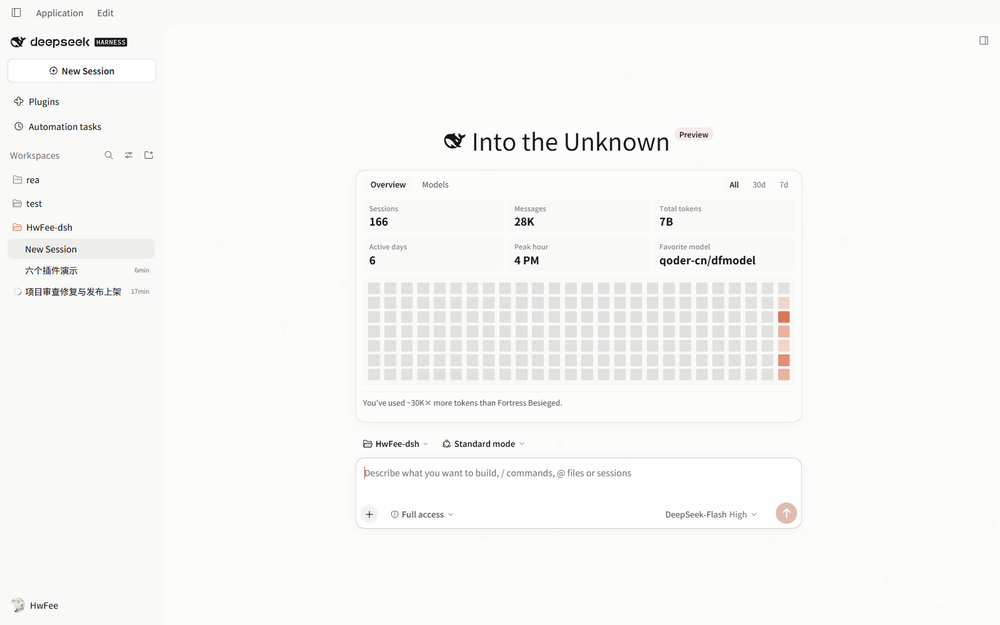
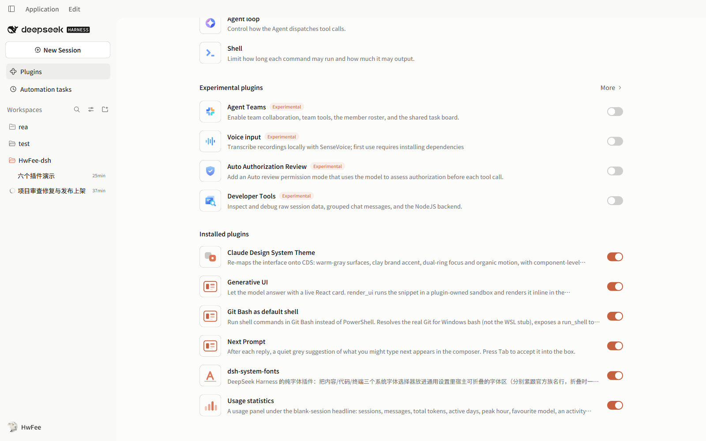
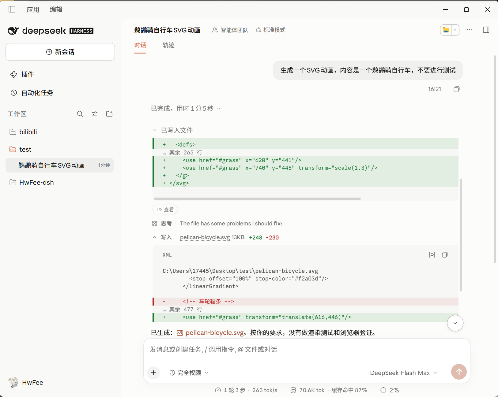
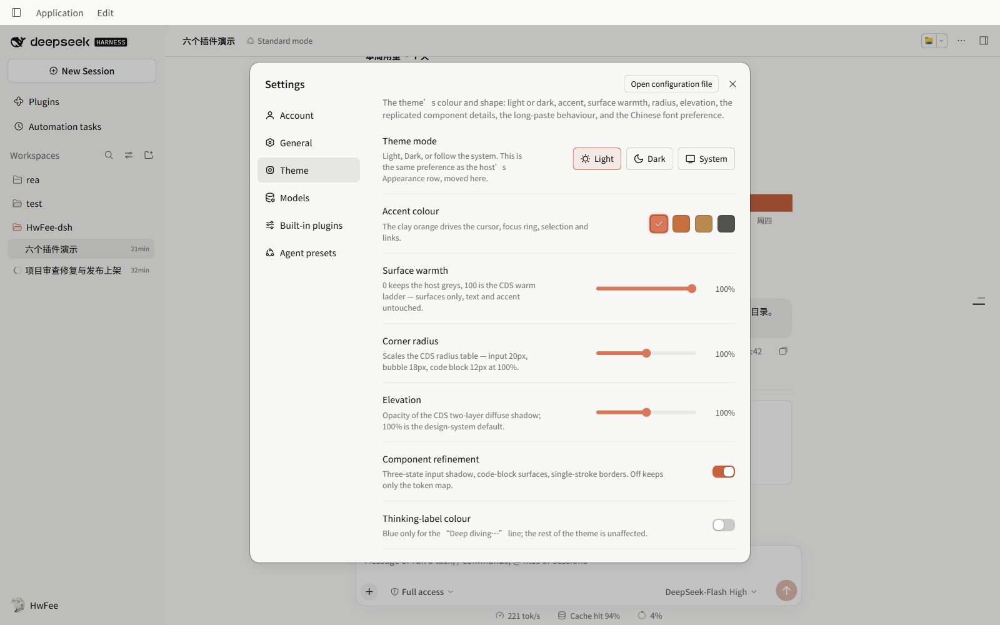
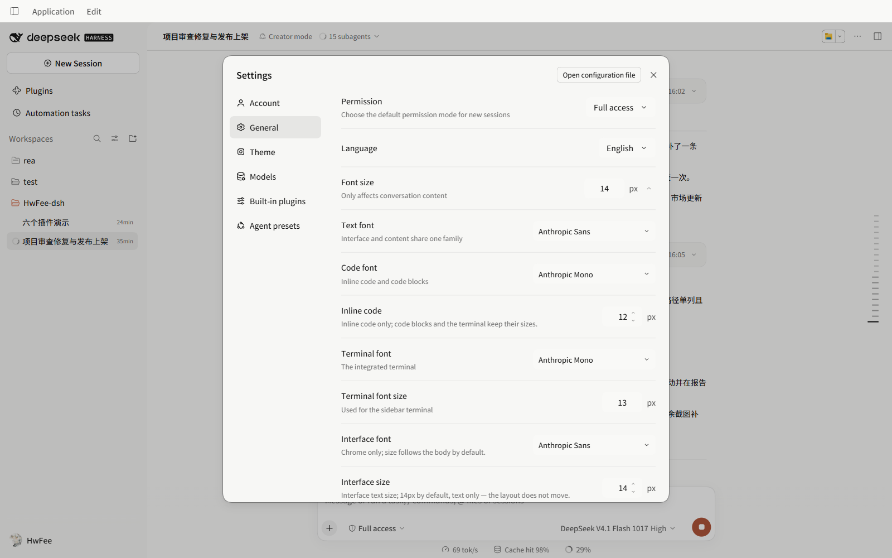
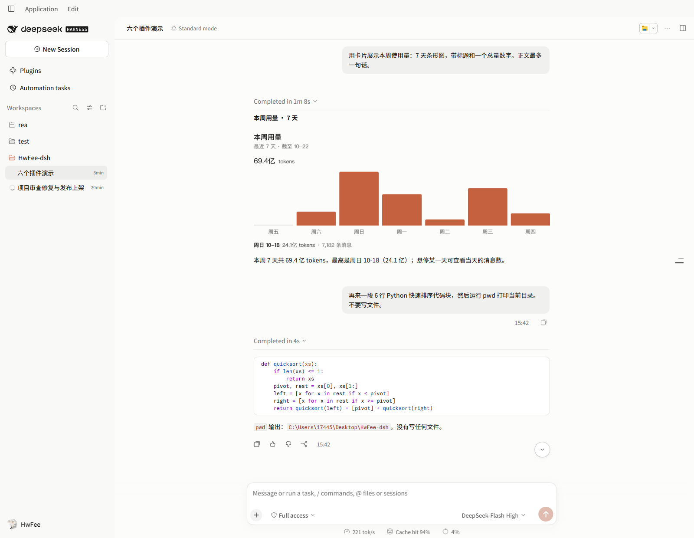
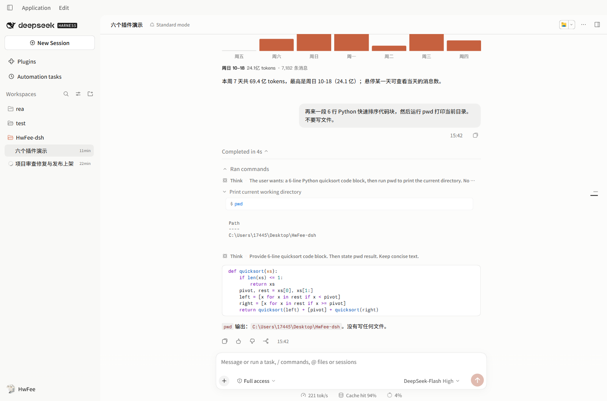
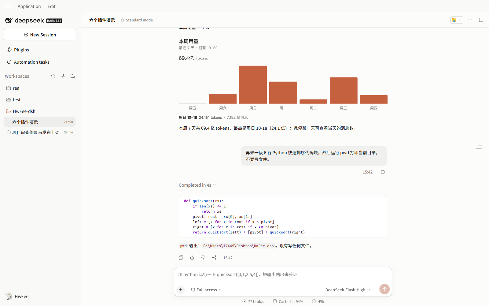

**English** | [简体中文](README-zh.md)

# HwFee-dsh

Six plugins for **DeepSeek Harness (DSH)**: a Claude Design System theme, font and size settings, a usage panel, generative UI cards, next-prompt prediction, and Git Bash behind a `run_shell` tool.



Chinese UI: [assets/screenshot-home-zh.png](assets/screenshot-home-zh.png).

## The six plugins

| Package | What it does | Install as |
|---|---|---|
| [`dsh-cds-theme`](https://www.npmjs.com/package/dsh-cds-theme) | Replaces the host's look: palette, typography, radii, shadows, and component styling for code blocks, tables and tool cards | `dsh-cds-theme` |
| [`dsh-system-fonts`](https://www.npmjs.com/package/dsh-system-fonts) | Font pickers for content, code, terminal and interface, plus inline-code and interface sizes, line height and tracking | `dsh-system-fonts` |
| [`@hwfee/dsh-usage-stats`](https://www.npmjs.com/package/@hwfee/dsh-usage-stats) | Usage panel on the new-session page, aggregated from local session logs | `@hwfee/dsh-usage-stats` |
| [`@hwfee/dsh-genui`](https://www.npmjs.com/package/@hwfee/dsh-genui) | `render_ui`: the model answers with an interactive card instead of prose | `@hwfee/dsh-genui` |
| [`@hwfee/dsh-git-bash`](https://www.npmjs.com/package/@hwfee/dsh-git-bash) | Routes `run_shell` through Git Bash on Windows, with a shell setting | `@hwfee/dsh-git-bash` |
| [`@hwfee/dsh-predict`](https://www.npmjs.com/package/@hwfee/dsh-predict) | Faint suggestion of your next message in the composer; Tab fills it in | `@hwfee/dsh-predict` |



Each plugin is a separate package with its own manifest, prebuilt client bundle and test suite. Install one or all six; disabling any of them restores the host.

## What each plugin does

### `dsh-cds-theme` — Claude-style theme

319 design tokens through the host's `overrideTokens` path (173 colour, 133 typography, 13 radius/shadow/motion, light and dark), plus component rules layered on stable `data-*` hooks rather than the host's hashed class names.

- **Component work**: serif display greeting on the blank page; framed Markdown tables with tinted headers and tabular numerals; white code blocks in light mode, `#1a1a19` in dark; a unified single-card layout for tool calls; theme-rendered diff and write cards with per-language syntax colour and word-level change highlighting.
- **A "Theme" settings page** beside General: light/dark/system, four accents, surface warmth, radius scale, shadow intensity, component-polish toggle, CJK font priority, long-paste-to-file, and an ASCII ocean on the blank page. Whale colours can be black, DeepSeek blue or changing; reduced motion freezes the scene.
- **Code blocks wrap by default**, and the host's "no wrap" toggle is removed — no-wrap is not a state this theme offers.





Limit: the theme targets specific host hooks and slots; a host change to those hooks can leave a component rule matching nothing until the plugin is updated. "Component polish" can be turned off to fall back to token-only theming.

Full settings list and implementation notes: [`plugins/cds-theme/README.md`](plugins/cds-theme/README.md).

### `dsh-system-fonts` — fonts and spacing

- **Four font slots**: content, code, terminal, and an interface family that follows the body until you set it. The host's three rows are replaced in place rather than duplicated.
- **Two pixel steppers**: interface size (10–20px, 14px when unset) scales interface text without moving layout; inline-code size (10–20px, 12px when unset) affects inline code only.
- **Line height and tracking sliders**, applied live.
- **Windows font discovery** merges GDI families, the registry and per-file OpenType names, so `PingFang SC` and `苹方-简` land in one entry.



Limit: it changes family and spacing only — no `font-weight`, no colour. Sizes hardcoded in the host's own CSS modules (sidebar and settings-row text) are not reachable from CSS; interface size reaches text nodes, not every fixed px.

Row order and font discovery: [`plugins/system-fonts/README.md`](plugins/system-fonts/README.md).

### `@hwfee/dsh-usage-stats` — local usage panel

A card under the greeting on the blank page, computed entirely from `~/.dsh/sessions` with no network request:

- **Six counters** — sessions, messages, tokens, active days, peak hour, top model — plus a Models tab with token shares, switchable between all time, 30 days and 7 days.
- **Activity heatmap** whose last cell is always today, and a comparison against a classic novel's word count.
- **Persistent ledger**: first cold scan takes seconds, later starts read a cache in `~/.dsh/cache/usage-stats/`. Counts only grow — deleting a session's log does not remove it from the totals; delete the ledger file to rebuild.

The panel is the card under the greeting in the screenshot at the top of this page.

Limit: it reads local logs, so a fresh machine starts at zero; the totals are a ledger, not a snapshot of what is on disk.

Cache, ledger and height setting: [`plugins/usage-stats/README.md`](plugins/usage-stats/README.md).

### `@hwfee/dsh-genui` — generative UI cards

The model calls `render_ui` and the result is a live React card in the conversation: charts, comparison tables, forms, toggles. Buttons change card state.



- **Card code runs in a sandboxed iframe** with `sandbox="allow-scripts"` and no `allow-same-origin`, so its document has an opaque origin; a CSP inside it removes the documented network APIs, navigation, nested frames and forms.
- **`interact()` is a request, not a send.** The host draws a confirmation row outside the frame with the exact sentence and send/discard buttons; only a click sends.
- **Own React**: React, ReactDOM and Scheduler are compiled into the frame at build time, so the card never touches the host's React or module table.
- Errors show in the card's place, with the source one click away.

Limit: it guarantees that card code cannot read the host page, storage or cookies, and cannot speak for you. It does not guarantee that model-written code is harmless — that code still runs, inside its own frame.

Exact CSP, message validation and what a card can do: [`plugins/genui/README.md`](plugins/genui/README.md).

### `@hwfee/dsh-git-bash` — Git Bash as the shell

Adds a `run_shell` tool and a **Default shell** row with three modes: Automatic, Windows PowerShell, Git Bash.

- **Finds real Git for Windows bash**, not the WSL stub at `C:\Windows\System32\bash.exe`: `DSH_GIT_BASH`, then `git --exec-path`, then known install paths.
- **Says where each command ran**: `· host` through the host's `ctx.shell` with the session's sandbox mode attached, `· direct` spawned by the plugin.
- **Fails closed**: Git Bash cannot run inside the Windows sandbox, so read-only, `workspace-write`, and undeterminable sessions are refused *before spawning*. The refusal points at Windows PowerShell; it never tells the caller to widen the sandbox. Only an explicit `danger-full-access` session runs Git Bash directly.
- **Cancellation, timeout and output overrun stop the real process tree**, not just the shell the plugin started.



Limit: on Windows, POSIX commands are only available in sessions that permit direct execution. In a restricted session the same request returns an error, by design.

Shell resolution and the sandbox decision table: [`plugins/git-bash/README.md`](plugins/git-bash/README.md).

### `@hwfee/dsh-predict` — next-prompt suggestion

After each reply, a grey suggestion of your next message appears in the composer. **Tab** fills it in without sending.



- **Side channel**: runs after `turn/end` through the host's LLM service with reasoning off. It writes no session log, opens no turn, and a failure leaves nothing in the conversation.
- **Sends excerpts to your provider**: each prediction is one short request carrying the last few turns, on the same provider, credentials and billing as a normal reply. The plugin opens no connection of its own; turn the row off to stop those excerpts leaving the machine.
- **Backs off**: three consecutive failures silence it for ten turns; a prediction over 20 seconds is dropped.

Limit: no prediction on the first turn of a session, and none when the model returns nothing — that is a normal empty result, not an error.

Settings, timing table and data flow: [`plugins/predict/README.md`](plugins/predict/README.md).

## Install

From a terminal:

```bash
dsh plugin --profile desktop add dsh-cds-theme
dsh plugin --profile desktop add dsh-system-fonts
dsh plugin --profile desktop add @hwfee/dsh-usage-stats
dsh plugin --profile desktop add @hwfee/dsh-genui
dsh plugin --profile desktop add @hwfee/dsh-predict
dsh plugin --profile desktop add @hwfee/dsh-git-bash
```

Or paste the same package name into **Settings → Plugins → Add Plugin**.

**Quit and restart DSH after adding or removing a plugin.** Bundles load when the app starts; a page refresh is not enough. Remove with the same command and `remove`:

```bash
dsh plugin --profile desktop remove dsh-cds-theme
```

This page never pins a version: take the current one from the npm page or the Releases page.

### Without an npm account: GitHub Releases

Every package also ships as a `.tgz` asset on [Releases](https://github.com/HwFee/HwFee-dsh/releases), one tag per package because the six version independently:

| | |
|---|---|
| Tag | `<plugin>-v<version>`, e.g. `cds-theme-v<version>` |
| Asset name | the `npm pack` filename; scoped packages drop the scope, so `@hwfee/dsh-genui` is `hwfee-dsh-genui-<version>.tgz` |
| Install | `dsh plugin --profile desktop add <asset URL or local .tgz path>` |

Open the release page and click the asset instead of building the URL — a missing `hwfee-` prefix or a kept `@scope/` is a 404.

Two install paths that do not work: a git subdirectory (`git+https://…#…&path:/plugins/…` — pnpm installs the repository root and ignores the path), and the old shared tag, whose assets are the first release only. Use the per-package tags.

### From source

Prebuilt `client/client.js` bundles are committed, so a clone can be linked directly:

```bash
git clone https://github.com/HwFee/HwFee-dsh.git
cd HwFee-dsh/plugins/cds-theme
npm ci && npm run build
dsh plugin --profile desktop add link:.
```

### If a version is missing

The default registry on many machines is `registry.npmmirror.com`, a read-only mirror that syncs late. When a version is missing or an install fails with `Unexpected end of TAR archive`, pin the version and use the official registry:

```bash
dsh plugin --profile desktop add dsh-cds-theme@<version> --config.registry=https://registry.npmjs.org
```

An unpinned install can still land on the previous version — we measured this on a machine with no `minimumReleaseAge` configured, so the cause is not identified. Pin the version, or use a Release asset, when you need the new build.

One consequence is worth knowing before you upgrade. Once a plugin is an npm/Release package rather than a `link:`, the profile no longer points at the workspace, so editing sources and rebuilding the bundle there has no effect until you install it with `link:` again; and a materialized install first clears the contents the `link:` pointed at, so doing this while the sources are not committed and pushed deletes workspace files.

## Fonts and licensing

The theme carries two kinds of font faces, with different licence terms:

| | |
|---|---|
| Inlined as `data:font/woff2` | **2** — subsetted Source Han Sans / Serif (Noto), SIL OFL, with `avar` weight calibration so Chinese strokes match the Latin weight steps. These are the only font bytes in the package |
| The six Anthropic faces (Sans / Serif / Mono × Roman / Italic) | commercial, **no redistribution licence**: declared as `local()` only, **zero bytes shipped** |
| What that means | with the families installed, `local()` resolves to them; otherwise the stack falls back to system families |
| Those six source files | removed from git tracking and blocked by `.gitignore`; a fresh clone does not contain them |
| Enforcement | the build refuses restricted bytes in the artifact, the package tests re-check the committed bundle and that the files stay untracked, the repo audit covers every artifact, and the release-asset gate opens the real tarball. Faces are identified by hashes and 96-byte prefixes in [`tools/font-licences.mjs`](tools/font-licences.mjs), so all four gates work without the files |

Releases built before this change still carry the eight inlined faces and are not retroactively fixed; install a build from after it. Details and the re-check commands are in [`market/PUBLISHING.md`](market/PUBLISHING.md).

## Security boundaries

Short version, no absolutes:

| Plugin | Boundary |
|---|---|
| `genui` | Card code runs in an iframe without `allow-same-origin`, so the host DOM, `localStorage` and cookies are unreadable to it, not merely hidden. Sending needs a click on the host's confirmation row. This does not make model-written code harmless, and the CSP covers the documented network APIs — extensions and proxies are outside it |
| `git-bash` | On Windows, Git Bash cannot enter the host sandbox, so restricted or undetermined sessions are refused before any process starts; only `danger-full-access` runs directly. Cancellation, timeout and output overrun stop the process tree |
| `predict` | Sends the last few turns to the provider you configured, as a normal model request |
| `usage-stats` | Reads `~/.dsh/sessions` and writes a count ledger; no network |

## Upgrading from an earlier version

Four changes a returning user will notice:

1. **Sending from a card takes one extra click.** `interact` now creates a pending request; the card cannot put text into the conversation by itself.
2. **Git Bash is refused in restricted Windows sessions.** Read-only and `workspace-write` sessions that used to run commands through it now get an error pointing at Windows PowerShell.
3. **Latin text renders in system fonts** on machines without the Anthropic families installed, because those faces are no longer embedded. Chinese is unaffected: the Noto subsets are still inline.
4. **New font rows start unset** and show their default values (interface and inline-code size) until you step them; nothing moves before that.

## Repository layout

```text
HwFee-dsh/
├── plugins/
│   ├── cds-theme/        # theme tokens + component rules
│   ├── system-fonts/     # font family and spacing rows
│   ├── usage-stats/      # local usage panel
│   ├── genui/            # render_ui cards
│   ├── predict/          # next-prompt ghost text
│   └── git-bash/         # run_shell through Git Bash
├── assets/               # screenshots used by these READMEs
├── market/               # market index, catalog entries, publish scripts
├── docs/                 # evidence docs (specs, host hooks, audits)
├── patches/              # optional host patches
└── tools/audit.mjs       # repo-wide static audit
```

Each plugin directory has its own `npm test`: build-freshness check first, manifest contract second, then the suites. Totals change with every fix, so read the output instead of a number here.

```bash
npm run build         # rebuild every plugin from the repository root
npm test              # run every plugin's freshness, manifest and behaviour checks
npm run audit         # unsafe DOM, observer lifecycle, token pairs and font assets
npm run verify        # theme-specific checks
```

Maintainer rules, including why a rebuilt bundle needs a full app restart rather than a refresh, are in [AGENTS.md](AGENTS.md).
