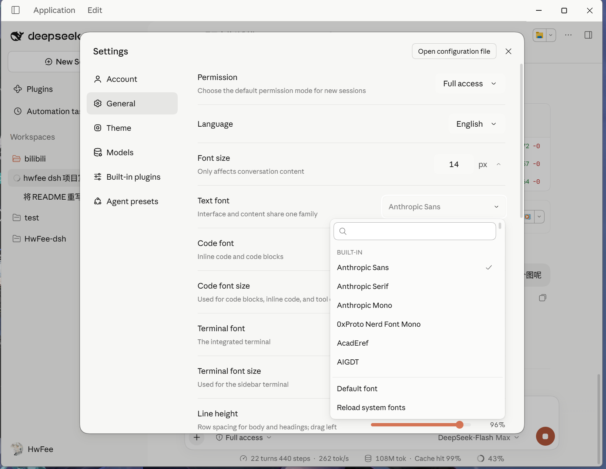

**English** | [简体中文](README-zh.md)

# HwFee-dsh

Six independent plugins for **DeepSeek Harness (DSH)**: a Claude Design System theme, a system font picker, a blank-session usage dashboard, generative UI cards, next-prompt prediction, and Git Bash as the default shell.

Each plugin ships its own manifest, pre-built client bundle and test suite. Install one or all six—they never touch each other's tokens or slots, and turning any of them off restores the host cleanly.

## Quick Install (Published on npm)

| Package | What it is |
|---|---|
| [`dsh-cds-theme`](https://www.npmjs.com/package/dsh-cds-theme) | CDS theme: palette, typography, radius, elevation, component polish |
| [`dsh-system-fonts`](https://www.npmjs.com/package/dsh-system-fonts) | Installed-font pickers for content / code / terminal / UI, plus line-height and tracking |
| [`@hwfee/dsh-usage-stats`](https://www.npmjs.com/package/@hwfee/dsh-usage-stats) | Usage dashboard on the blank-session page |
| [`@hwfee/dsh-genui`](https://www.npmjs.com/package/@hwfee/dsh-genui) | `render_ui`: the model answers with a live React card |
| [`@hwfee/dsh-predict`](https://www.npmjs.com/package/@hwfee/dsh-predict) | Grey ghost text suggesting your next message; Tab fills it |
| [`@hwfee/dsh-git-bash`](https://www.npmjs.com/package/@hwfee/dsh-git-bash) | Git Bash as the shell behind a `run_shell` tool |

**Read the current version from npm, not from this file** — the latest is whatever the npm page shows, and those links stay correct across releases:

```bash
npm view dsh-cds-theme version --registry=https://registry.npmjs.org
```

Run in your terminal, or paste the package name into **Settings → Plugins → Add Plugin** inside DSH:

```bash
dsh plugin --profile desktop add dsh-cds-theme
dsh plugin --profile desktop add dsh-system-fonts
dsh plugin --profile desktop add @hwfee/dsh-usage-stats
dsh plugin --profile desktop add @hwfee/dsh-genui
dsh plugin --profile desktop add @hwfee/dsh-predict
dsh plugin --profile desktop add @hwfee/dsh-git-bash
```

**Fully quit and restart DSH after installing or removing a plugin.** Plugins are wired during profile startup and do not hot-load into a running window.

To uninstall:

```bash
dsh plugin --profile desktop remove dsh-cds-theme
dsh plugin --profile desktop remove dsh-system-fonts
dsh plugin --profile desktop remove @hwfee/dsh-usage-stats
dsh plugin --profile desktop remove @hwfee/dsh-genui
dsh plugin --profile desktop remove @hwfee/dsh-predict
dsh plugin --profile desktop remove @hwfee/dsh-git-bash
```

> **Regional mirror lag.** The default registry on many machines is `registry.npmmirror.com`, a read-only mirror that syncs after the official registry. If a version is missing or the install reports `Unexpected end of TAR archive`, pin the version and pull from the official registry:
> ```bash
> dsh plugin --profile desktop add dsh-cds-theme@<version> --config.registry=https://registry.npmjs.org
> ```
> **Unpinned installs can lag one release.** pnpm's `minimumReleaseAge` withholds versions younger than its cutoff from range resolution, so `add <name>` may resolve to an older release while `add <name>@<version>` gets the one you asked for.

---

## Screenshots

| Chat & Tool Calls | Code Block & Diff |
| :---: | :---: |
|  |  |

| Theme Settings Page | Blank Session (Serif Greeting + Usage Card) |
| :---: | :---: |
|  |  |

| Font Rows in General Settings | Next-Prompt Ghost Text |
| :---: | :---: |
|  |  |

<details>
<summary>English UI preview (all settings and labels follow the host language)</summary>


</details>

---

## What Each Plugin Does

### 1. `dsh-cds-theme` — Theme & Component Overhaul

Built from [Caho1/open-claude-ui](https://github.com/Caho1/open-claude-ui) (MIT, a clean-room reconstruction of Anthropic's Claude Design System), adapted where DSH's own layout needed different calls.

- **319 design tokens via `overrideTokens`**: DSH writes active theme tokens inline onto `<body>`, so plain CSS rules cannot override them. The plugin registers a token layer for both light and dark modes — 173 colour tokens (warm-grey surfaces, clay accent `#d97757` / `#c6613f`, `hsla(0,0%,8%,α)` hairline borders, two-layer diffuse shadows, three-layer focus rings), 133 typography tokens, and 13 radius/shadow/motion tokens.
- **Fonts it may actually ship**: 2 subsetted Source Han Sans/Serif files with `avar` stem-weight calibration, so Chinese glyphs match Latin stroke weights across all 8 weight steps. These are the only font bytes in the package. The six Anthropic faces are declared as `local()` references — they render only on a machine that already has those families installed, and no bytes leave the tarball. See [below](#font-licensing).
- **Component polish**: Serif display greeting on blank sessions (38px / wght 330); framed Markdown tables with tinted headers and tabular numerals; white code blocks in light mode and `#1a1a19` in dark; soft breathing shimmer on the thinking label.
- **Standalone "Theme" settings page**: Sits in the settings sidebar right next to General. Includes Light / Dark / System mode, 4 accents (Clay, Ochre, Sand, Graphite), surface warmth, corner radius scale, shadow intensity, component refinement toggle, original-blue thinking label toggle, automatic `@` file reference for long pastes (>2,000 chars or >30 lines), and CJK font priority.
- **Blank-session click ripple (WIP, toggleable)**: Reconstructs the short-lived Claude Code desktop home backdrop (faint code punctuation + radial light waves on click). Still rough around the edges—turn it off anytime at the bottom of the Theme page.

See [`plugins/cds-theme/README.md`](plugins/cds-theme/README.md) for the full technical breakdown.

### 2. `dsh-system-fonts` — Local Font Pickers & Spacing

Changes font families, line-height, and letter-spacing—nothing else. It never emits `font-weight`, leaving the theme's weight hierarchy intact.

- **Four font slots**: Content / Code / Terminal keep the host's own rows, plus an **Interface** family that defaults to following the body. It also adds two pixel steppers (interface size, inline-code size) next to the host's own size rows.
- **Windows font discovery**: Merges GDI `InstalledFontCollection`, Registry `Fonts` keys, and per-file OpenType metadata so English and localized CJK family names resolve together.
- **Live sliders**: Line-height (`50%–100%`) and letter-spacing (`−0.30em` to `+0.30em`), applied immediately.

See [`plugins/system-fonts/README.md`](plugins/system-fonts/README.md).

### 3. `@hwfee/dsh-usage-stats` — Local Session Usage Card

Adds a usage panel below the blank-session greeting, aggregated locally from `~/.dsh/sessions/*.zstd` with zero network uploads.

- **Six counters & per-model breakdown**: Sessions, messages, total tokens, active days, peak hour, and top model, plus a Models tab with token shares. Switch between All Time, 30 Days, and 7 Days.
- **Activity heatmap & book comparison**: Rolling 7-row grid anchored with Today at the bottom-right, paired with a randomized comparison against classic books.
- **Persistent disk cache**: Session logs are concatenated multi-frame zstd files. The first cold scan takes ~2s; subsequent startups read from `~/.dsh/cache/usage-stats/` in ~20ms. Panel height (`240–520px`, default 344) and number units (`K/M/B` vs `万/亿`) live on the Theme settings page.

See [`plugins/usage-stats/README.md`](plugins/usage-stats/README.md).

### 4. `@hwfee/dsh-genui` — Generative UI Cards

The model calls `render_ui` and the answer renders as an interactive React card in the conversation instead of prose: charts, comparison tables, forms, toggles. Buttons change card state, and a card can ask to send a message that **you confirm before it goes out**.

- **Runs in a sandboxed frame.** The card is a separate document with an opaque origin, so it cannot read the app's page, its storage or your cookies. Inside that document the network is blocked and forms cannot submit. Exact CSP and message validation: [`plugins/genui/README.md`](plugins/genui/README.md).
- **Your click is the only send path.** A card can ask to send a message, but it only becomes a pending request shown under the card; pressing **Send this choice** is what puts it in the conversation, and **Discard** sends nothing.
- **Own React, no CDN.** React / ReactDOM / Scheduler are compiled into the frame at build time (MIT, notices ship in the package), so the card never touches the host's React instance.
- **The card's height is its own.** The frame reports its content height after render, so a chart that grows or a form that expands does not clip or leave a nested scrollbar in the transcript.
- **One built-in skill** teaches when a card beats prose, what the frame allows, and how to style with host tokens so light and dark both work.
- **Crash-visible**: parse errors, render throws, a frame that tries to navigate away, and bad arguments all show the reason in the card's place, with the source one click away.

What it does **not** promise: that no network is reachable under any circumstances (the CSP blocks the documented web APIs; extensions or proxies are outside it), or that model-written code is harmless — it still runs, just without access to your app's page, storage or cookies.

See [`plugins/genui/README.md`](plugins/genui/README.md).

### 5. `@hwfee/dsh-predict` — Next Prompt Suggestion

After each reply, a quiet grey suggestion of what you might type next appears in the composer. **Tab** fills it in without sending.

- **Side channel**: prediction runs after `turn/end` through the host's own LLM service with reasoning switched off. It writes no session log, opens no turn, and a failure leaves no error in the conversation.
- **Sends the recent conversation to your provider**: each prediction is one short request carrying the last few turns, on the same provider, credentials and billing as a normal reply. The plugin opens no connection of its own; turn the setting off if you do not want those excerpts leaving the machine.
- **Backs off**: three consecutive failures silence it for ten turns; a prediction that exceeds 20 seconds is dropped.
- **Model choice**: follows the current model by default, or pin one from the host's model catalogue.

See [`plugins/predict/README.md`](plugins/predict/README.md).

### 6. `@hwfee/dsh-git-bash` — Git Bash as the Shell

Adds a `run_shell` tool and a **Default shell** settings row with three modes: Automatic / Windows PowerShell / Git Bash.

- **Finds the real Git for Windows bash**, never the WSL stub at `C:\Windows\System32\bash.exe`: `DSH_GIT_BASH` first, then `git --exec-path`, then the known install locations.
- **Reports where each command ran**: `· host` means it crossed the host's `ctx.shell`, with the session's sandbox mode attached to the request; `· direct` means the plugin spawned it itself.
- **Fails closed when the policy is unknown.** Git Bash cannot run inside the Windows sandbox, so `run_shell` refuses *before spawning anything* when the session is `read-only`, `workspace-write`, or its sandbox mode cannot be resolved (missing policy service, no session, unrecognised mode). The refusal points at Windows PowerShell, an equivalent PowerShell command, or the user — it never tells the caller to widen the sandbox mode. Only an explicit `danger-full-access` session may run Git Bash directly. Automatic mode still picks the shell by the usual rule; the session policy only decides whether that command may run, and the plugin never swaps interpreters behind your back.
- **Honours cancellation**: the abort signal reaches whichever executor runs the command, and a call that is already cancelled does not spawn at all.
- **Degrades visibly**: when no shell resolves, the row says which configuration fact is wrong instead of the plugin disappearing.

See [`plugins/git-bash/README.md`](plugins/git-bash/README.md).

---

## Font licensing

Six **Anthropic** web variable fonts (Sans / Serif / Mono × Roman / Italic) are commercial faces with **no redistribution licence**. They are **not part of this repository**: they are untracked, gitignored local working copies on the developer's machine, and a fresh clone does not contain them. Inlining them into an npm tarball would publish them to everyone who installs.

**What the current build does (verified on the committed artifact, 2026-10-22):**

| | |
|---|---|
| Inlined as `data:font/woff2` | **2** — the two subsetted Source Han (Noto) faces, SIL OFL, calibrated by this project |
| The six Anthropic faces | declared as `local("Anthropic Sans" / "Anthropic Serif" / "Anthropic Mono")` only — **zero bytes in the tarball** |
| What that means for you | on a machine where those families are installed, the `local()` rule resolves to the installed face; otherwise the stack falls through to system families. Nobody has published a side-by-side visual comparison of the two states yet |
| How the faces are identified | [`tools/font-licences.mjs`](tools/font-licences.mjs) holds a sha256 and the first 96 bytes (base64) per face — no binaries — so every gate works on a clone that has never seen the six files |
| Enforcement | the build refuses when a restricted face's bytes reach the artifact, `plugins/cds-theme/test/fonts.test.mjs` re-checks the committed bundle **and** that the six files are not tracked, `tools/audit.mjs` checks every plugin's artifact plus local-copy drift, and `market/check-release-assets.mjs` opens the real tarball and names what it finds |

- **Published versions before this fix are a different story.** `dsh-cds-theme@0.1.5` on npm was built the old way and does carry all eight faces inline; it is not retroactively fixed. Install the theme at this version or later, or expect the old tarball to contain those bytes.
- `market/PUBLISHING.md` records how to verify this yourself, what the old tarball contains, and what changes visually once the Latin faces fall back.

---

## Other Ways to Install (Market / Release Tarballs / Source)

DSH has three plugin entry points, and they do not accept the same input:

| Where | What to enter |
|---|---|
| **CLI**: `dsh plugin --profile desktop add <spec>` | npm package name, `.tgz` URL, or `link:<dir>` |
| **GUI: Settings → Plugins → Add Plugin** | Same `<spec>` as CLI |
| **GUI: Plugins → Discover** (requires Custom Plugin Market enabled) | Market `index.json` URL only |

**Option A: Custom Plugin Market**

Enable "Custom Plugin Market" in DSH settings and add:

```text
https://raw.githubusercontent.com/HwFee/HwFee-dsh/master/market/index.json
```

**Option B: GitHub Release Tarballs**

Releases are tagged per package, because the six packages version independently:

| | |
|---|---|
| Release list | <https://github.com/HwFee/HwFee-dsh/releases> |
| Tag | `<plugin>-v<version>` — e.g. `cds-theme-v0.1.5`, `genui-v0.1.0` |
| Asset name | the `npm pack` filename; scoped packages **drop the scope** — `@hwfee/dsh-genui` ships as `hwfee-dsh-genui-<version>.tgz` |
| Full URL shape | `https://github.com/HwFee/HwFee-dsh/releases/download/<plugin>-v<version>/<asset>` |

Open the release page and click the asset rather than building the URL by hand — the two rules above are exactly where hand-built URLs go wrong (a missing `hwfee-` prefix or a kept `@scope/` is a 404).

> Do not use `git+https://github.com/HwFee/HwFee-dsh.git#...&path:/plugins/...`—pnpm's git resolver installs the repository root and ignores subdirectory parameters.
>
> **Do not install from the old shared tag.** `v0.1.0` still exists and still answers, but its assets are the first-release tarballs, and `v0.1.1` has no release at all. Only the per-package tags carry current builds.

**Option C: Local Source Checkout**

Pre-built `client/client.js` bundles are committed to git, so a fresh clone can be linked immediately:

```bash
git clone https://github.com/HwFee/HwFee-dsh.git
cd HwFee-dsh/plugins/cds-theme
npm ci && npm run build
dsh plugin --profile desktop add link:.
```

---

## Repository Layout & Tests

Every plugin has its own `npm test`: build-freshness check first, manifest contract second, then the suites. Run it in a plugin directory and read the numbers it prints — totals change with every fix, so treat the command output as the authority:

```bash
cd plugins/cds-theme
npm test

# Repo-wide bundle budget, DOM safety, observer/effect lifecycle & token-pair checks
node tools/audit.mjs
```

Last full run of all six suites (committed artifacts, all green): **2026-10-22**.

```text
HwFee-dsh/
├── plugins/
│   ├── cds-theme/        # CDS theme plugin
│   ├── system-fonts/     # Installed-font pickers + spacing
│   ├── usage-stats/      # Blank-session usage dashboard
│   ├── genui/            # render_ui generative cards
│   ├── predict/          # Next-prompt ghost text
│   └── git-bash/         # Git Bash shell + run_shell tool
├── market/               # Market index.json, catalog entries, publish & install scripts
├── docs/                 # Evidence docs (cds-spec.md, host-hooks.md, audits)
├── assets/               # Preview screenshots
├── patches/              # Host patches (diff hunk line numbers, diff start)
└── tools/audit.mjs       # Repo-level static audit
```

> `skills/dsh-plugin-guide/` is a bundled third-party developer reference (Apache-2.0) containing archived DeepSeek docs; none of the plugins depend on it at runtime.
